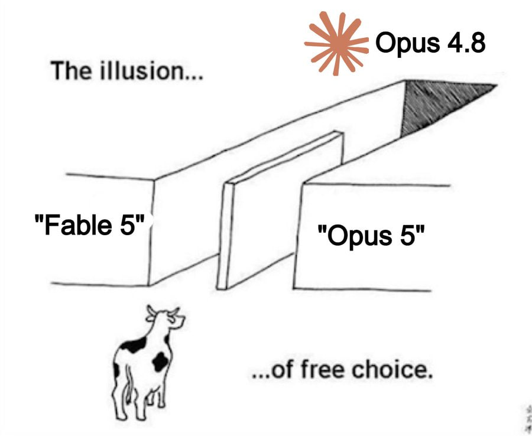
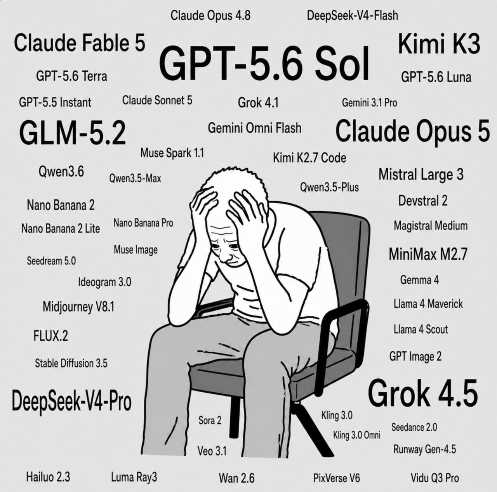
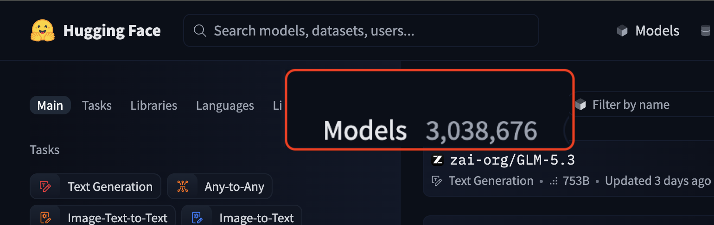
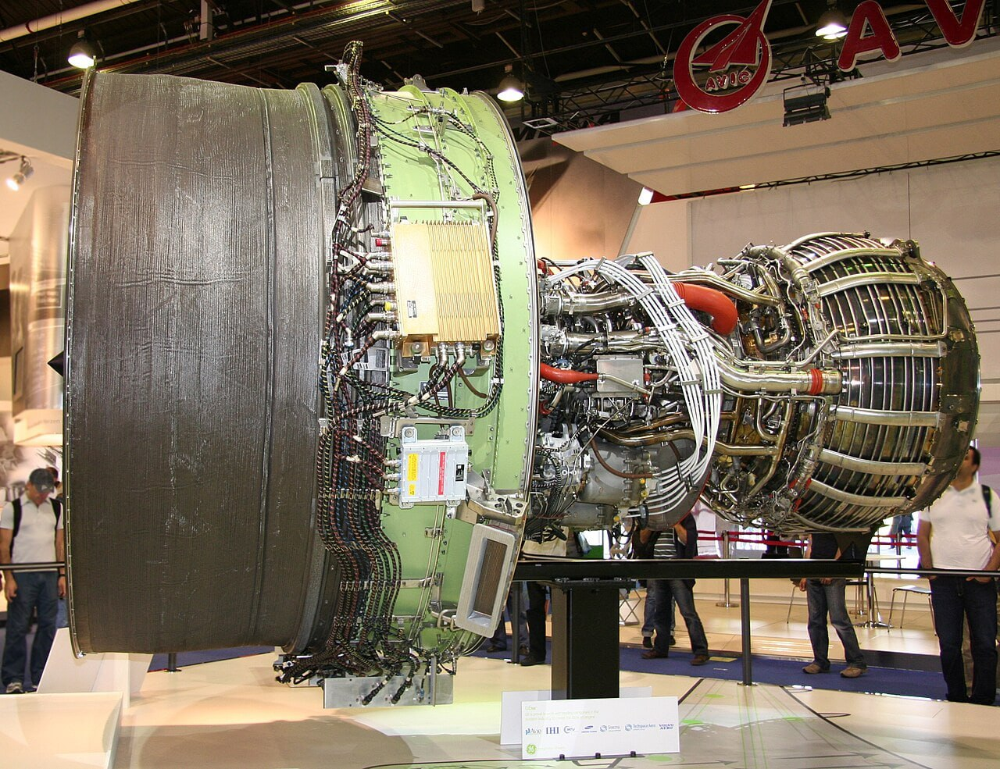

# От ноутбука до multi-GPU
## Инфраструктура и софт для локального запуска LLM

Практический алгоритм выбора инструментов для локального запуска LLM (август 2026)

- Что запускать, на чём, сколько стоит и как обслуживать

---
layout: section
---

# А зачем?

---
layout: default
---

# Где уже используется AI?

AI в 2026 году вышел далеко за пределы чата. Сценарии, которые уже работают:

<v-clicks>

- **Код** — генерация, ревью, тесты
- **Текст и документы** — чаты, ИИ-поиск и поиск по документации
- **Агенты** — автоматизация рабочих задач
- **Транскрибация и голос** — Whisper, голосовые ассистенты
- **Медиа** — фото и видео

> Кто использует AI во всех сценариях? Ежедневно?

</v-clicks>

---
layout: image
image: /assets/pay-variants.png
backgroundSize: contain
title: Варианты оплаты
---

---
layout: image
image: /assets/subs-price-api-value.svg
backgroundSize: contain
class: bg-black
title: Сколько по-настоящему стоит подписка
---

---
layout: center
title: Когда решил оплатить подписку в ChatGPT с юридического лица
---

<v-clicks>

  

</v-clicks>

---
layout: default
title: Ограничения со стороны правительства
---

# Риски регуляторики и ограничений

Доступ к внешним облачным моделям находится под двойным давлением:

  

    <h3 class="font-bold text-base text-gray-800">🇷🇺 Внутренние ограничения (РФ, 2026)</h3>
    <ul class="text-sm mt-2 space-y-2 text-gray-700">
      <li><strong>Полномочия на запрет:</strong> закон марта 2026 расширил права регуляторов по ограничению и блокировке зарубежных AI-инструментов.</li>
      <li><strong>Безопасность данных:</strong> требования по КИИ, ФЗ-152 и защите коммерческой тайны делают внешний cloud-инференс юридически рискованным.</li>
      <li><strong>Риск непрерывности:</strong> вероятность внезапного отключения рабочих сервисов и инструментов разработки.</li>
    </ul>
  

  

    <h3 class="font-bold text-base text-gray-800">🌏 Внешние барьеры (Пекин и Запад)</h3>
    <ul class="text-sm mt-2 space-y-2 text-gray-700">
      <li><strong>Лимиты из Пекина:</strong> обсуждение мер по ограничению трансграничного доступа к передовым китайским AI-моделям (Qwen, Kimi, DeepSeek).</li>
      <li><strong>Санкционные фильтры:</strong> блокировки аккаунтов, карт и корпоративных подписок со стороны западных провайдеров.</li>
      <li><strong>Технологическая автономия:</strong> зависимость от внешнего API ставит бизнес под удар геополитики.</li>
    </ul>
  

  <blockquote>
    <strong>Вывод:</strong> Доверять критические процессы чужому облаку нельзя. Локальный запуск open-weight моделей — единственный способ гарантировать бесперебойность.
  </blockquote>

---
layout: center
title: Модели за которые мы платим, оказываются не тем что есть на самом деле
---

# Советские стандарты качества

---
layout: image
image: /assets/abliterated-lora.png
backgroundSize: contain
title: Модели со снятыми ограничениям - потенциал для локального запуска
---

---
layout: default
---

# Зачем локально?

1. **Контроль**
   - Версия модели и квантизация
   - Без сюрпризов от провайдера
2. **Безопасность и закон**
   - ФЗ-152, КИИ, коммерческая тайна. Утечка = риск
3. **Автономность и доступность**
   - Изоляция
   - Без лимитов
   - Без риска блокировки
4. **Кастомизация**
   - Дообучение и модель под задачу

---
layout: section
---

# Выбор модели

---
layout: center
---

# Трудности выбора модели

---
layout: center
---

# Сколько всего моделей на Hugging Face?

<v-clicks>

</v-clicks>

---
layout: image
image: /assets/model-classification.png
backgroundSize: contain
title: Классификация моделей
---

---
layout: default
---

# Где смотреть рейтинги моделей?

При выборе модели для реальных задач стоит опираться на независимые лидерборды:

  

    <h3 class="font-bold"><a href="https://arena.ai/leaderboard/code/webdev/fullstack" target="_blank">arena.ai</a></h3>
    

      Слепые A/B-тесты (LMSYS Chatbot Arena). Специализированный лидерборд для webdev и fullstack-разработки.
    

  

  

    <h3 class="font-bold"><a href="https://llm-stats.com/leaderboards/best-ai-for-coding" target="_blank">llm-stats.com</a></h3>
    

      Сводная статистика и актуальный рейтинг лучших моделей для написания и рефакторинга кода.
    

  

  

    <h3 class="font-bold"><a href="https://artificialanalysis.ai/models#intelligence-breakdown" target="_blank">artificialanalysis.ai</a></h3>
    

      Независимый бенчмарк качества (intelligence breakdown), скорости инференса (токены/сек) и стоимости.
    

  

  
На что обращать внимание:

  <ul class="mt-1 space-y-1 text-gray-600">
    <li><strong>Coding & Agentic benchmarks:</strong> оценивайте тесты на реальном коде, а не синтетические метрики.</li>
    <li><strong>Соотношение качество / размер:</strong> для локального запуска критичен баланс VRAM и скорости.</li>
  </ul>

<!--
layout: image
image: /assets/kimi-k3-score.png
backgroundSize: contain

layout: image
image: /assets/self-hosted-kimi.png
backgroundSize: contain
-->

---
layout: image
image: /assets/big-isnot-better.jpg
backgroundSize: contain
class: bg-black
title: Маленькие модели могут быть не хуже
---

---
layout: section
---

# Софт

---
layout: image
image: /assets/soft-for-llm.png
backgroundSize: contain
title: Какой софт использовать для запуска LLM
---

---
layout: section
---

# Инференс

---
layout: image
image: /assets/llm-inference.webp
backgroundSize: contain
title: Как работает инференс
---

---
layout: image
image: /assets/mlm-prefill-vs-decode.png
backgroundSize: contain
title: Различия prefill и decode
---

---
layout: section
---

# Железо

---
layout: default
---

# 4 ценовые категории

1. **Ультрабюджет (до 100 тыс. ₽)**
2. **Народный (100–200 тыс. ₽)**
3. **Рабочая станция (200–600 тыс. ₽)**
4. **Enterprise (от 600 тыс. ₽)**

<!--
layout: image
image: /assets/work-hardware.png
backgroundSize: contain
title: Сравнение сборок для домашнего запуска LLM
class: bg-black
-->

---
layout: default
title: Таблица со сравнением на 2026 год
---

# Сравнение платформ для инференса (2026)

  <table class="w-full text-xs border-collapse">
    <thead>
      <tr class="bg-gray-100 text-gray-800 border-b-2 border-blue-500">
        <th class="py-1.5 px-2 text-left font-bold">Параметр</th>
        <th class="py-1.5 px-2 text-left font-bold text-blue-600">NVIDIA RTX 4090</th>
        <th class="py-1.5 px-2 text-left font-bold">Apple Mac Mini M5 Pro</th>
        <th class="py-1.5 px-2 text-left font-bold">AMD Ryzen AI Halo</th>
        <th class="py-1.5 px-2 text-left font-bold text-orange-600">NVIDIA DGX Spark</th>
      </tr>
    </thead>
    <tbody class="divide-y divide-gray-200">
      <tr>
        <td class="py-1 px-2 font-semibold text-gray-700">Price (USD)</td>
        <td class="py-1 px-2 font-semibold">$1,599</td>
        <td class="py-1 px-2 font-semibold">$1,699</td>
        <td class="py-1 px-2 font-semibold">$3,999</td>
        <td class="py-1 px-2 font-semibold">$4,699</td>
      </tr>
      <tr>
        <td class="py-1 px-2 font-semibold text-gray-700">Chip / Arch</td>
        <td class="py-1 px-2">Ada Lovelace</td>
        <td class="py-1 px-2">M5 Pro</td>
        <td class="py-1 px-2">Ryzen AI Max+ 395</td>
        <td class="py-1 px-2">GB10 Grace Blackwell</td>
      </tr>
      <tr>
        <td class="py-1 px-2 font-semibold text-gray-700">Memory / Bandwidth</td>
        <td class="py-1 px-2"><strong>24GB GDDR6X</strong> / 1010 GB/s</td>
        <td class="py-1 px-2"><strong>24–64GB</strong> / 307 GB/s</td>
        <td class="py-1 px-2"><strong>128GB LPDDR5X</strong> / 256 GB/s</td>
        <td class="py-1 px-2"><strong>128GB LPDDR5X</strong> / 273 GB/s</td>
      </tr>
      <tr>
        <td class="py-1 px-2 font-semibold text-gray-700">Token gen (Llama3 8B)</td>
        <td class="py-1 px-2 text-green-700 font-semibold">~105 tok/s</td>
        <td class="py-1 px-2">~45 tok/s</td>
        <td class="py-1 px-2">~45 tok/s</td>
        <td class="py-1 px-2 font-semibold">~55 tok/s</td>
      </tr>
      <tr>
        <td class="py-1 px-2 font-semibold text-gray-700">Token gen (gpt-oss 120B)</td>
        <td class="py-1 px-2 text-red-500 font-semibold">No Fit (мало VRAM)</td>
        <td class="py-1 px-2 text-red-500 font-semibold">No Fit (&lt;120GB)</td>
        <td class="py-1 px-2 text-green-700 font-semibold">~34 tok/s</td>
        <td class="py-1 px-2 text-green-700 font-semibold">~39 tok/s</td>
      </tr>
      <tr>
        <td class="py-1 px-2 font-semibold text-gray-700">Latency (TTFT)</td>
        <td class="py-1 px-2 font-semibold text-green-700">~35 мс</td>
        <td class="py-1 px-2">~120 мс</td>
        <td class="py-1 px-2">~150 мс</td>
        <td class="py-1 px-2">~70 мс</td>
      </tr>
      <tr>
        <td class="py-1 px-2 font-semibold text-gray-700">Software stack</td>
        <td class="py-1 px-2">CUDA / vLLM / SGLang</td>
        <td class="py-1 px-2">Apple MLX / Ollama</td>
        <td class="py-1 px-2">ROCm / Vulkan / llama.cpp</td>
        <td class="py-1 px-2">CUDA / vLLM / TensorRT-LLM</td>
      </tr>
      <tr>
        <td class="py-1 px-2 font-semibold text-gray-700">TDP (Потребление)</td>
        <td class="py-1 px-2 text-red-600 font-semibold">450W</td>
        <td class="py-1 px-2 text-green-700 font-semibold">145W</td>
        <td class="py-1 px-2 text-green-700 font-semibold">140W</td>
        <td class="py-1 px-2">240W</td>
      </tr>
    </tbody>
  </table>

  💡 <em>RTX 4090 — лидер по скорости на моделях до 32B, но для моделей 70B–120B+ уже нужно VRAM от 128 ГБ (AMD Halo, DGX Spark).</em>

---
layout: center
---

# Почему не серверные GPU?

  
  

---
layout: collage
title: Цены на авито
---

  

  

  

  

  

  

---
layout: collage
title: Что еще продают на авито
---

  

  

  

  

  

  

---
layout: section
---

# Юнит-экономика

---
layout: default
title: "Юнит-экономика и расчеты: методика расчета стоимости 1M токенов на своем железе (RTX 4090)"
---

# Расчёт стоимости 1M токенов (On-Premise)

<h4 class="!mb-1 text-gray-800">Базовая формула</h4>

$$
\text{Cost}_{1\text{M}} = \frac{\text{GPU\_hour\_price}}{\text{TPS}_{\text{peak}} \times U \times 3600} \times 10^6
$$

где $U$ — утилизация (доля отданных токенов от пика), $\text{TPS}_{\text{eff}} = \text{TPS}_{\text{peak}} \times U$.

<h4 class="!mb-1 text-gray-800">Стоимость GPU-часа (CAPEX)</h4>

$$
\text{GPU\_hour} = \frac{\text{CAPEX}}{\text{Life}_{\text{hours}}} + P_{\text{kW}} \times \text{Tariff}
$$

- **CAPEX:** 400 000 руб. за сервер RTX 4090 (24 ГБ).
- **Амортизация (2 года = 17 520 ч):** $400\,000 / 17\,520 =$ **22.83 руб./ч**.
- **Электроэнергия (TDP 450 Вт, 8 руб./кВт·ч):** $0.45 \text{ кВт} \times 8 \text{ руб.} =$ **3.60 руб./ч**.
- **Полная стоимость часа:** $22.83 + 3.60 =$ **26.43 руб./час**.

<h4 class="!mb-1 text-gray-800">Расчёт для RTX 4090</h4>

$\text{TPS}_{\text{peak}} = 45\text{ tok/s}$

**Высокая нагрузка ($U = 50\%$):** ~32.6 ₽ / 1M токенов

$$
\frac{26.43}{45 \times 0.50 \times 3600} \times 10^6 \approx 32.63\text{ руб.}
$$

**Офисный сценарий ($U = 10\%$):** ~163.1 ₽ / 1M токенов

$$
\frac{26.43}{45 \times 0.10 \times 3600} \times 10^6 \approx 163.15\text{ руб.}
$$

**Редкие запросы ($U = 2\%$):** ~815.7 ₽ / 1M токенов

---
layout: default
title: "Аренда выделенного GPU RTX 4090 в Selectel"
---

# Аренда GPU: стоимость 1M токенов (Dedicated)

<h4 class="!mb-1 text-gray-800">Параметры тарифа Selectel</h4>

- **Конфигурация:** Сервер с 1× RTX 4090 24 ГБ.
- **Ежемесячная стоимость:** 62 309 руб. / месяц.
- **Количество часов в месяце:** $30 \times 24 = 720\text{ часов}$.

Стоимость 1 часа аренды:

$$
\text{GPU\_hour} = \frac{62\,309\text{ руб.}}{720\text{ ч}} \approx \mathbf{86.54\text{ руб./час}}
$$

(включает электричество, стойку, канал, базовую поддержку)

<h4 class="!mb-1 text-gray-800">Входные данные для инференса</h4>

- Модель: **Qwen3.8-27B**.
- Пиковая скорость: $\text{TPS}_{\text{peak}} = 45\text{ tok/s}$.
- Реалистичная утилизация: $U = 10\%$.

#### Расчёт стоимости при $U = 10\%$

$$
\text{Cost}_{1\text{M}} = \frac{\text{GPU\_hour}}{\text{TPS}_{\text{peak}} \times U \times 3600} \times 10^6
$$

Подставляем значения:

$$
\text{Cost}_{1\text{M}} = \frac{86.54}{45 \times 0.10 \times 3600} \times 10^6 \approx \mathbf{534.2\text{ руб.}}
$$

~534 ₽ за 1 миллион токенов

<h4 class="!text-[11px] !mb-1 text-gray-700">Сравнение при разной утилизации:</h4>

Нагрузка 50%

~106.8 ₽

Нагрузка 10%

~534.2 ₽

Нагрузка 2%

~2 671 ₽

📌 *Облачный dedicated GPU снимает CAPEX, но час в ~3.3 раза дороже своего железа.*

---
layout: default
title: "Сравнение экономики 1M токенов: On-Premise, Selectel и Cloud.ru"
---

# Сравнение стоимости 1M токенов

Вариант 1

<h3 class="font-bold text-sm text-gray-800 mt-1 mb-2">Своё железо (CAPEX)</h3>

- **Сервер:** 1× RTX 4090 (400k ₽)
- **Час работы:** ~26.4 ₽/час

- При $U = 50\%$: **~33 ₽**
- При $U = 10\%$: **~163 ₽**
- При $U = 2\%$: **~816 ₽**

✅ Мин. цена при нагрузке 
⚠️ Нужен начальный бюджет

Вариант 2

<h3 class="font-bold text-sm text-gray-800 mt-1 mb-2">Selectel (Dedicated)</h3>

- **Аренда:** 1× RTX 4090 (62.3k ₽/мес)
- **Час работы:** ~86.5 ₽/час

- При $U = 50\%$: **~107 ₽**
- При $U = 10\%$: **~534 ₽**
- При $U = 2\%$: **~2 671 ₽**

✅ Быстрый старт без покупки 
⚠️ Оплата за всё время (24/7)

Вариант 3

<h3 class="font-bold text-sm text-gray-800 mt-1 mb-2">Cloud.ru (Pay-as-you-go)</h3>

- **Модель:** Qwen3 (Models API)
- **Тариф:** 43 ₽ вх. / 173 ₽ вых.

Средневзвешенная смесь ($3:1$ in/out):

$$
\text{Cost}_{1\text{M}} = \frac{3 \times 43 + 1 \times 173}{4} \approx \mathbf{75.5\text{ руб.}}
$$

✅ 0 ₽ в моменты простоя 
⚠️ Растет линейно с трафиком

> **Точка безубыточности:** Если утилизация ниже ~15–20%, Pay-as-you-go (75–100 ₽/1M) выгоднее аренды GPU в облаке. Но если у вас стабильный поток (U > 30%) — своё железо выигрывает у всех в 2–5 раз (~33 ₽/1M).

---
layout: default
---

# Краткие рекомендации

- **Один человек:**
  - Mac (mini) M5 Pro 24+ ГБ + Qwen3.6-35B-A3B + MLX/Ollama
- **Команда / небольшая компания:**
  - 1–2× RTX 4090 24 ГБ + Qwen3.8-27B + vLLM/SGLang
- **Корпоративный контур / десятки-сотни пользователей:**
  - multi-GPU NVIDIA H100 80 ГБ + ... + vLLM/SGLang
  - multi-GPU MetaX C550 64 ГБ + ... + vLLM/SGLang

---
layout: section
---

# Итоги

---
layout: default
---

# Итоги

- Локальный LLM — это про **контроль, безопасность и предсказуемость**, а не про «максимальное качество любой ценой».
- В 2026 году открытые модели уже закрывают **80% повседневных IT-задач** (см. [`harness`](https://en.wikipedia.org/wiki/Agent_harness)).
- Главное — считать экономику и выбирать стек под реальную нагрузку.

---
layout: image
image: /assets/the-end-qr.png
backgroundSize: contain
class: bg-black
title: Спасибо за внимание
---

  <h2 class="font-bold">
    <a href="https://centi-conf.gainanov.pro/"
       target="_blank"
       style="position: absolute; top: 400px; left: 65px;">
      centi-conf.gainanov.pro
    </a>
  </h2>

---
layout: q-and-a
title: Вопросы
---
